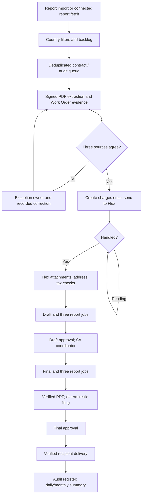
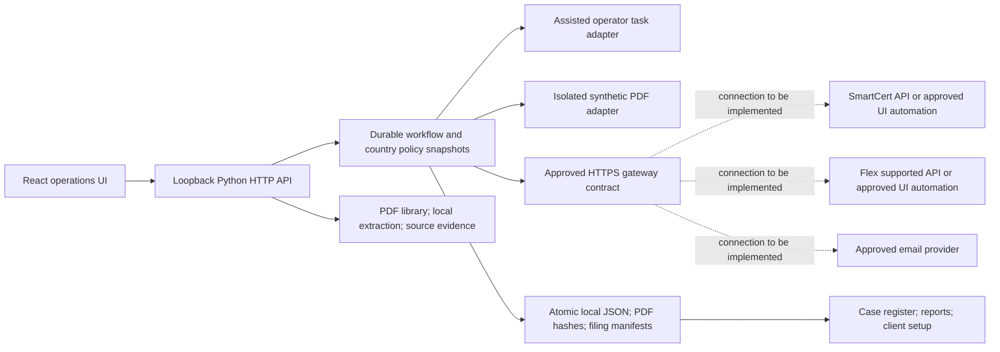

# Veritas invoicing application

The local application supports assisted execution for real work and isolated
demo execution. Connected execution is an adapter boundary, not an implemented
SmartCert or JD Edwards connector. Portal URLs, approved APIs, sandbox access,
service accounts and client policy confirmations are still required for live use.

## What is implemented

| Requirement | Application behavior |
| --- | --- |
| Work pickup | CSV/XLSX import, report preambles, country aliases, policy-based filters and per-audit queue; approved gateway report-fetch endpoint for a future connection |
| Dubai selection | A/AE, configured BU aliases, Completed/Confirmed/Frozen; billing month plus older uninvoiced audits; explicit invoiced flags excluded |
| South Africa selection | ZA, exact duplicate removal; conflicting audit records require correction; configured audit eligibility |
| Three-source matching | Report vs signed-contract vs Work Order amount, currency, audit type and start date; explicit Work Order identity and existence |
| Contract evidence | Local PDF text/OCR, page evidence and unresolved fields; uploaded PDFs retained by checksum; human confirmation of all financial facts |
| Charges and Flex | Durable operator tasks in assisted mode; gateway operations in connected mode; stable idempotency keys, Handled check, attachments and address/tax validation |
| Approvals | Named draft/final approvals; South Africa draft requires country coordinator; country roles configurable |
| Jobs | Print Invoices - Contract Billing, Sales Order Batch and EDI Invoice Extraction must complete for new runs |
| Filing | Final invoice number required; PDF filed by country/month and invoice number/date/customer; checksummed manifest; conflicting files never overwritten |
| Delivery | Assisted mode records an actual externally sent message and verified contract contacts; demo delivery is synthetic; gateway connection must implement real sending |
| Exceptions | Mismatched task evidence records a blocked financial state and operator event; case ownership, notes and resolution never override validations |
| Reporting | Processed, pending, exceptions, awaiting review and finalized counts; daily/monthly issuance totals separated by currency; CSV export |
| Client setup | Scope decisions, missing details, baseline volumes/time/error rate, SLA and commercial inputs; country configuration with audited change history |

## Use the application

Start `start-web.ps1` and open <http://127.0.0.1:8765/#invoicing>. The top bar
selects Demo, Assisted or Connected workspace and a named operator. Financial
state is isolated between workspaces. Demo opens populated with labeled samples;
previous documents and earlier runs remain available.

1. Choose Assisted and enter the operator name.
2. Import the real WIP XLSX/CSV with country and billing month. Older Dubai
   uninvoiced work is included; future work is excluded.
3. Advance the queued run to create its first operator task.
4. Upload the signed contract PDF and any Work Order evidence in Evidence.
   Review extracted suggestions against the original. Multi-year or unclear
   amounts/man-days must be confirmed; extraction does not authorize billing.
5. In Operator tasks record independently verified contract and Work Order facts.
   Report facts are shown for comparison. Structured fields use JSON lists or
   objects for dates, report jobs and multi-line South Africa attachments.
6. Each next external step creates another task. A person performs that step in
   the approved portal and records the result. Never confirm an action that did
   not occur. Invalid evidence is routed to Exceptions for a named reviewer.
7. Review draft and final evidence in Work queue. South Africa requires the
   country coordinator role at draft review. Approved final PDFs are filed.
8. After actual delivery using the approved mail system, record its message ID
   and all contract contact recipients. The assisted app itself does not send.
9. Use Reports for daily/monthly values and Configuration to complete discovery,
   baseline/SLA inputs and country policy setup.

Local operator names and roles are attestations, not authenticated employee
identities. The server remains loopback-only. Enterprise authentication and
authorization must be added before any shared/network production deployment.

## To-be process and exception paths

Pending jobs use bounded checks. Unknown external mutation outcomes are held for
reconciliation, never retried with a new invoice identity. The recorded operation
key is reconciled against the gateway's durable outcome. Corrected evidence must
pass the original validation. Case closure is administrative and cannot authorize
a mismatched invoice.

## Architecture

The gateway is a client-owned integration contract. It must authenticate to the
approved systems, download the actual PDFs into the managed evidence workspace,
scope reports to the correct job/order and honor mutation idempotency keys.
SmartCert Salesforce API and Flex AIS/Orchestrator are candidates from the
requirements; availability/licensing has not been established. Screen automation
requires real flow recordings/selectors and sandbox tests before implementation.
No endpoints, credentials or selectors are guessed.

Policies in `config/countries.json` control country aliases, business units,
status/audit eligibility, backlog, split-charge behavior, approval role, required
facts and tax jurisdictions. Workspace overrides are validated and audited;
new runs capture a policy snapshot. Adding a country using existing operation
types is configuration. A country needing a new portal flow or calculation
requires a new tested adapter capability, not merely another country name.

This version uses atomic files and workspace process locks, appropriate for a
single local service. A shared multi-user deployment requires a transactional
database/queue, authenticated role enforcement, worker coordination, centrally
managed evidence storage, retention and backups. It is not represented as a
production multi-tenant platform.

## Required client decisions

Configuration captures the proposal format, South Africa detail/header wording,
South Africa VAT policy, escalation owner, file naming convention and CCE/RCE
definition. These discovery notes are not executable code or templates; country
rules and verified evidence are separately validated. No production SA VAT rate
is inferred. AE10/AE11 and the specified 5% checks follow the supplied Dubai
requirements; exceptions need a confirmed policy.

Access discovery must confirm portal URLs, supported operations, authentication,
sandbox/service accounts and mail provider. Do not enter passwords or bearer
tokens in the UI; gateway credentials are environment settings. Confirm customer
email sending scope and the required approval roles before connecting delivery.

## Effort and commercials worksheet

The local implementation is available for validation. The following are planning
ranges for the remaining integration pilot, not a quote or a commitment:

| Work package | Indicative person-days | Dependency |
| --- | ---: | --- |
| Client discovery, sample review and confirmed rules | 3–5 | Client SMEs and representative artifacts |
| System-access proof and integration design | 3–6 | Sandbox and service accounts |
| SmartCert gateway integration | 5–10 | Supported read/write operations |
| Flex gateway integration and job/PDF reconciliation | 7–15 | Supported order/invoice operations |
| Email integration and authenticated approval controls | 4–8 | Identity and mail environment |
| Dubai pilot tests and reconciliation | 4–7 | Sandbox invoices and finance reviewers |
| South Africa policy/templates and pilot | 4–8 | Confirmed VAT and comment templates |
| Operational hardening and handover | 3–6 | Deployment and support requirements |

These assumptions total 33–65 person-days after access is granted; unavailable
APIs, UI automation, client delays or multi-user deployment can change scope and
effort. Commercials = agreed effort × agreed day rate, plus separately agreed
hosting, gateway/API, OCR/model, identity and support costs. No prices are assumed.
Configuration records the client's entered day rate/hourly cost and baseline.

Baseline manual hours/month = monthly volume × minutes/invoice ÷ 60. Measure
assisted/automated time and exceptions during the pilot before claiming savings.
ROI requires observed time reduction and agreed operating costs; the app does
not manufacture a savings percentage.

## Pilot acceptance and rollout

1. Client confirms assisted vs full scope, email scope and Dubai policies.
2. Obtain samples for no-PO/PO, backlog, split lines, fees, foreign currency,
   mismatches, duplicate rows, job delays and revised signed proposals.
3. Prove sandbox connectivity without issuing production invoices.
4. Compare every proposed charge and draft with the current manual baseline.
5. Demonstrate duplicate prevention, wrong-recipient rejection, unknown-outcome
   reconciliation, approval enforcement and checksum-protected filing.
6. Finance approves reconciliation results and measures turnaround/error rates.
7. Connect production only after identity, access, controls and support are agreed.
8. Add South Africa after approved attachment templates and tax treatment; then
   expand to further countries using versioned policy and adapter tests.

## Verification and limits

Automated tests exercise the assisted HTTP flow from imported WIP through manual
tasks, source matching, approvals, final PDF filing and recorded delivery. They
also cover configuration-only country extension, backlog, report completeness,
duplicates, changed artifacts, unknown outcomes and currency-separated reporting.
This verifies local behavior; it does not verify an unconnected production portal.
